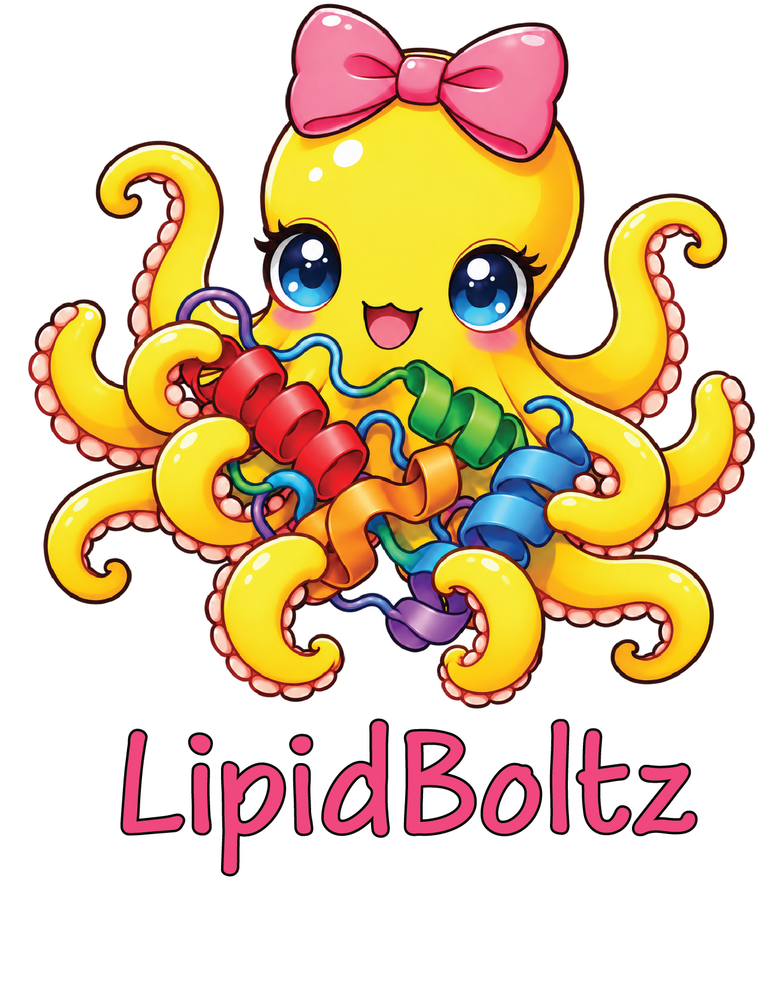

# LipidBoltz
<p align="center">
  
</p>

## Introduction
LipidBoltz is an open-source co-folding model for predicting 3D lipid–protein complex structures, with a focus on non-annular lipid–protein interactions. Built upon the [Boltz-1](https://github.com/jwohlwend/boltz) framework, LipidBoltz uses specialized fine-tuning strategies to improve lipid binding pose accuracy while preserving protein structure prediction quality, providing a tool for studying lipid–protein interactions and their biological roles.


## Installtion
```bash
# Clone this repository
git clone https://github.com/zoeyxyang/LipidBoltz.git
cd LipidBoltz

# Create your own virtual environment
python -m venv .venv
source .venv/bin/activate

# Install dependencies (load cuda and adjust the torch version based on your cuda)
pip install torch==2.7.1 torchvision torchaudio --index-url https://download.pytorch.org/whl/test/cu128
# If you use a differnt version, edit torch_constraints.txt accordingly 
python -m pip install --no-cache-dir -c torch_constraints.txt -e '.[cuda]'

# Verify the installtion
python -c "import boltz; print(boltz.__file__)"
command -v boltz

```

## Prediction

1. Activate environment
```bash
source .venv/bin/activate
# install hugging face
pip install -U huggingface_hub
```

2. Obtain LipidBoltz model weights from Hugging Face:
```bash
hf download zoeyxyang/lipidboltz \
  lipidboltz.ckpt \
  --local-dir /PATH-TO/checkpoints/
```

3. Run a prediction with an example lipid-protein query
```bash
boltz predict example/query.yaml \
  --checkpoint /PATH-TO/checkpoints/lipidboltz.ckpt \
  --out_dir /PATH-TO/predictions \
  --cache /PATH-TO/cache_directory \
  --model boltz1 \
  --recycling_steps 10 \
  --diffusion_samples 5 \
  --no-confidence \
  --use_potentials \
  --use_msa_server
```


## Reproduce Training
1. Activate environment
```bash
source .venv/bin/activate
```


2. Download the preprocessed data of LipidBoltz from Hugging Face:
```bash
hf download zoeyxyang/lipidboltz_data \
    lipidboltz_preprocessed.tar.zst \
    --repo-type dataset \
    --local-dir /PATH-TO/finetune_inputs/
```

```bash
tar --use-compress-program=zstd \
    -xf /PATH-TO/finetune_inputs/lipidboltz_preprocessed.tar.zst \
    -C /PATH-TO/finetune_inputs/
```


3. Obtain a pretrained checkpoints and a symmetry file:

You will need `boltz1_conf.ckpt` and `symmetry.pkl`\
Those files are originated from:  https://github.com/jwohlwend/boltz. \
You can refer to the instruction there to get those files.  \
Here is an example to get those files:

```bash
# Pretrained Boltz-1:
python -c 'from pathlib import Path; from boltz.main import download_boltz1; download_boltz1(Path("PATH-TO/cache"))'

# Symmetry file:
wget https://boltz1.s3.us-east-2.amazonaws.com/symmetry.pkl
```


4. Run the training

Adjust the paths and wandb configuration in the configtation file in `scripts/train/configs/lipidboltz.yaml`, then run:

```bash
# Run training
export PYTHONPATH="${PATH_TO_REPO}/src:${PYTHONPATH:-}"
python scripts/train/train.py scripts/train/configs/lipidboltz.yaml
```
